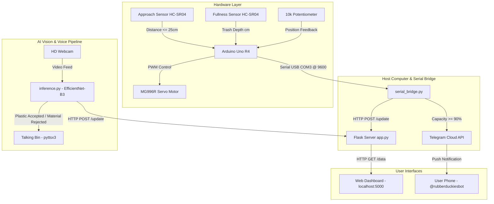

# Smart DuckieBin - AI & IoT Smart Waste Management System

[](https://www.python.org/)
[](https://www.arduino.cc/)
[](https://pytorch.org/)
[](https://t.me/rubberduckiesbot)
[](LICENSE)

An intelligent, touchless, AI-powered smart waste management system developed for [LUTES Hackathon 2026](https://luma.com/lutes-fb3w). **SmartBin** combines embedded sensor telemetry, computer vision material classification, real-time closed-loop servo actuation, a dynamic animated web dashboard, spoken voice feedback, and instant Telegram push alerts.

---

## Features

1. **Touchless Lid Automation**:
   - Automatically detects approaching hands or objects within 25 cm using an ultrasonic sensor.
   - Opens the lid, holds for 3 seconds, and securely closes it.
2. **Closed-Loop High-Torque Servo Control**:
   - Powered by a TowerPro MG996R metal-gear continuous servo paired with an analog potentiometer for real-time closed-loop position feedback.
3. **Internal Fullness & Depth Telemetry**:
   - An internal lid-mounted ultrasonic sensor measures waste height.
   - Calculates real-time fill volume ($0\% - 100\%$) calibrated between empty (16 cm) and full (2 cm).
4. **Edge AI Material Classifier (Plastic-Only Bin)**:
   - Custom **EfficientNet-B3** deep learning vision model running real-time webcam inference.
   - Specifically designated as a **Plastic-Only Bin**:
     - **Plastic Detected**: Accepted (`✅ Plastic Accepted (94%)`), green indicators.
     - **Cardboard, Metal, Paper, Glass, Battery, etc.**: Rejected (`🚫 Rejected: Cardboard`), red alert indicators.
5. **"Talking Bin" Voice Assistant**:
   - Audio feedback spoken directly through the host computer using `pyttsx3`:
     - *"Thank you for recycling correctly! Plastic accepted."*
     - *"Warning! Cardboard detected. This bin is for plastic only."*
6. **Telegram Notifications**:
   - Connects to **@rubberduckiesbot** via Telegram Bot API.
   - Automatically dispatches emergency alerts directly to sanitation staff's phones when bin capacity crosses $\ge 90\%$.
7. **Live Animated Web Dashboard**:
   - Responsive dashboard with animation, animated lid synchronization, live percentage readouts, and live AI material inspection badges.

---

## Live Demo Links

- **Local Web Dashboard**: [http://localhost:5000](http://localhost:5000)
- **Telegram Bot Channel**: [@rubberduckiesbot](https://t.me/rubberduckiesbot)

---

## Hardware Specifications

| Component | Model / Specification | Purpose | Connection / Pin |
| :--- | :--- | :--- | :--- |
| **Microcontroller** | Arduino Uno R4 | Central hardware sensor controller & servo driver | USB Serial to Host PC (COM3, 9600 baud) |
| **Servo Motor** | TowerPro MG996R (Metal Gear) | High-torque continuous rotation servo driving the bin lid | Digital Pin **11** (PWM signal) |
| **Position Feedback** | 10kΩ Rotary Potentiometer | Physical lid angle / position sensing (closed-loop servo PID) | Analog Pin **A0** |
| **Approach Sensor** | HC-SR04 Ultrasonic Sensor | Detects human approach to trigger automatic lid opening | **Trig: Pin 9**, **Echo: Pin 10** |
| **Fullness Sensor** | HC-SR04 Ultrasonic Sensor | Downward-facing sensor measuring internal trash level | **Trig: Pin 6**, **Echo: Pin 5** |
| **Vision Camera** | HD USB Webcam / Laptop Camera | Captures garbage items in real-time for neural network inference | USB Port (Camera ID 0) |
| **Audio Output** | Host Speakers / Headphones | Vocalizes text-to-speech warnings and recycling confirmation | SAPI5 / pyttsx3 Audio Driver |
| **Power Supply** | 5V / 2A External Power Supply | Dedicated power supply for MG996R high-stall servo motor | Breadboard Power Rails (Shared Ground) |

### Arduino Pinout Summary
```text
 Arduino Uno Pinout:
 ├── [D5]  <-- Fullness Sensor ECHO
 ├── [D6]  --> Fullness Sensor TRIG
 ├── [D9]  --> Lid Proximity Sensor TRIG
 ├── [D10] <-- Lid Proximity Sensor ECHO
 ├── [D11] --> MG996R Servo Signal
 ├── [A0]  <-- 10k Potentiometer Wiper (Lid Position)
 ├── [5V]  --> Sensor VCC / Potentiometer VCC
 └── [GND] --> Common Ground (Arduino + Sensors + Servo PSU)
```

---

## System Architecture



---

## How It Works

### 1. Distance & Ultrasonic Telemetry
Distance is calculated by pulsing the ultrasonic trigger for $10\,\mu\text{s}$ and measuring the round-trip echo pulse duration ($\Delta t$):
$$\text{Distance (cm)} = \frac{\Delta t}{2 \times 29.1}$$
- **Fullness Calibration**:
  $$\text{Volume Fill \%} = \left( \frac{\text{EMPTY\_CM} - \text{Distance}}{\text{EMPTY\_CM} - \text{FULL\_CM}} \right) \times 100\%$$
  *(Where $\text{EMPTY\_CM} = 16.0\text{ cm}$ and $\text{FULL\_CM} = 2.0\text{ cm}$. Readout clamped between $0\%$ and $100\%$.)*

### 2. Closed-Loop Servo P-Controller
Because the MG996R is a continuous rotation servo, standard angular servo commands do not hold position. The Arduino reads the physical angle via the potentiometer on `A0` and adjusts servo velocity dynamically:
$$\text{Error} = \text{Target} - \text{Position}$$
If $|\text{Error}| > \text{Deadband}$, it commands forward pulse (`1700 µs`) or reverse pulse (`1300 µs`) until reaching the calibrated open (`400`) or closed (`200`) target positions.

### 3. Edge AI Garbage Classifier
- **Model**: `EfficientNet-B3` loaded from `garbage_classifier_best.pt`.
- **Pretrained Classes**: `battery`, `biological`, `cardboard`, `clothes`, `glass`, `metal`, `paper`, `plastic`, `shoes`, `trash`.
- **Classification Rules**:
  - The bin is locked to **PLASTIC ONLY**.
  - When **Plastic** is classified with confidence $\ge 55\%$:
    - Result: **Accepted**
    - Spoken Audio: *"Thank you for recycling correctly! Plastic accepted."*
    - Dashboard Badge: Green glowing `✅ Plastic Accepted`.
  - When **Cardboard**, **Metal**, **Paper**, or another material is detected:
    - Result: **Rejected**
    - Spoken Audio: *"Warning! [Material] detected. This bin is for plastic only."*
    - Dashboard Badge: Red glowing `🚫 Rejected: [Material] (Plastic Only!)`.

### 4. Telegram Alert Dispatch & Anti-Spam Hysteresis
- When calculated volume reaches $\ge 90\%$, `serial_bridge.py` posts a high-priority Markdown alert to the user's Chat ID via the Telegram Bot API.
- **Hysteresis**: To prevent sending repeated alerts while the bin remains full, the alert flag latches on and only resets once the bin is physically emptied below $80\%$.

---

## How to Run the Project

### 1. Clone the Repository & Install Dependencies
```powershell
git clone https://github.com/hannaszalai/SmartTrashCan.git
cd SmartTrashCan

pip install flask pyserial requests python-dotenv torch torchvision opencv-python pyttsx3 paho-mqtt
```

### 2. Configure Environment Variables
Create a file named `.env` in the project root:
```env
TELEGRAM_BOT_TOKEN="YOUR_TELEGRAM_BOT_TOKEN_HERE"
TELEGRAM_CHAT_ID="YOUR_NUMERIC_CHAT_ID_HERE"
```

### 3. Flash Arduino Firmware
1. Open [servo_fullness.ino](file:///servo_fullness.ino) in the Arduino IDE.
2. Select your board (**Arduino Uno**) and the active COM port.
3. Click **Upload**.

### 4. Start the Services

Open three terminal windows:

#### Terminal 1 — Start the Web Dashboard
```powershell
python app.py
```
*Access the live monitor at [http://localhost:5000](http://localhost:5000).*

#### Terminal 2 — Start the Arduino Serial Bridge
```powershell
python serial_bridge.py
```
*Reads telemetry from Arduino on `COM3`, streams to the dashboard, and handles Telegram alerts.*

#### Terminal 3 — Launch the AI Material Classifier
```powershell
python inference.py --model garbage_classifier_best.pt
```
*Launches the webcam classifier window. Hold plastic or non-plastic items in front of the camera to test!*

---

## Repository Structure

```text
SmartTrashCan/
├── .env                          # Local credentials (bot token & chat ID)
├── .gitignore                    # Git ignore file protecting .env and weights
├── app.py                        # Flask live dashboard server with lid & liquid animations
├── garbage_classifier_best.pt    # PyTorch EfficientNet-B3 model checkpoint
├── inference.py                  # Real-time computer vision classifier & voice announcer
├── serial_bridge.py              # Serial bridge connecting Arduino, Flask & Telegram
├── test_telegram.py              # Mock test script for Telegram alert dispatch
├── servo_fullness.ino            # Final production Arduino sketch (Sensors + Servo control)
├── LICENSE                       # MIT License
└── README.md                     # Project documentation
```

---

## Hackathon Value & Impact

- **Eliminates Contamination at the Source**: Prevents non-recyclable materials from contaminating single-stream plastic recycling through instant audio-visual rejection.
- **Optimized Waste Collection**: Real-time fullness telemetry and Telegram alerts eliminate overflowing public bins and unnecessary collection truck trips, cutting carbon emissions.
- **Engaging User Experience**: Interactive lid animations, visual feedback, and voice interaction make recycling engaging and educational for citizens.

---

## Team
- **Hanna Szalai**
- **Anh Quan Pham**
- **Behnaz Alavinezhad**
- **Rasheli Jayalath**